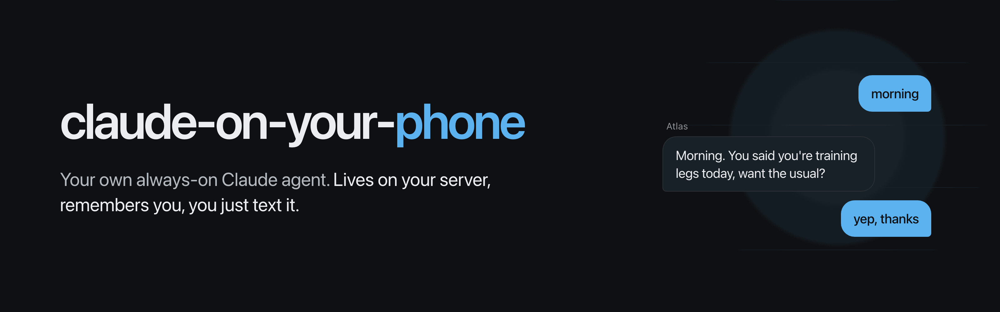
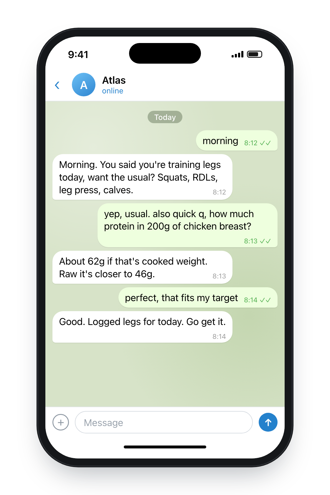
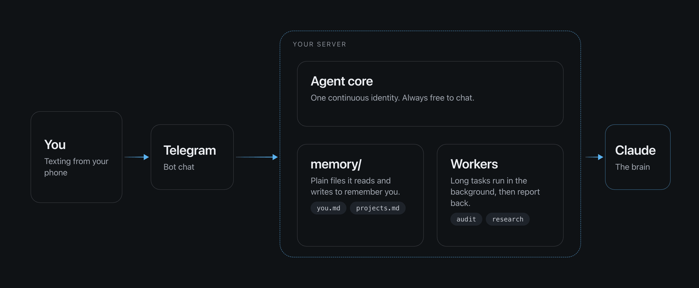

<p align="center"></p>

<p align="center">
  
  
  
  
  
</p>

# Claude on your phone

**Your agent lives on your server, remembers you, and you just text it.**

It is Claude Code running 24/7 on a small Linux server. You message it in Telegram like a friend. It has a name and a personality you choose, it keeps notes about you in plain files, and it picks up where you left off, even days later and after a reboot. Your laptop can be off.

<p align="center"></p>

## What you get

- **An identity.** `CLAUDE.md` says who the agent is and how it talks. You edit it in plain words.
- **Memory.** A folder of markdown notes (`memory/`). The agent reads them at the start of every session and writes new facts, decisions and preferences as it learns them.
- **Never runs out of context.** It cleans up its own conversation automatically and keeps the thread: past about 60% of the context window, or after a long quiet gap, it saves a handoff note and starts a fresh session that gets the note plus your last few messages. You never notice, and you never need `/compact`.
- **Background workers.** Long jobs go to a separate worker process, so the agent stays free to chat. It says "on it", and the worker texts you when done.
- **Fast lane.** Message it while it is busy and you get a quick answer right away, not a queue.
- **Learns while you sleep.** A nightly job reads the day's chat, updates its notes, keeps a journal, and notes mistakes you corrected. Bigger ideas are proposed to you in the morning and never applied without your ok.
- **Proactive, but quiet.** A light heartbeat decides every half hour whether there is anything worth texting you. The default answer is no. At most three messages a day.
- **Schedules.** `/schedule every weekday 8:00 brief me on my calendar`.
- **Your chat never goes dark because of background jobs.** A usage guard queues workers at 60% of your plan and pauses them at 80%.
- **Always on.** A system service: starts at boot, restarts itself on failure.
- **Private.** Only your Telegram account can talk to it.

<p align="center"></p>

---

## Setup

You need a VPS running Ubuntu or Debian (2 GB RAM is plenty) with SSH access, a Claude Pro or Max plan (or an API key), and a Telegram account. About 10 minutes.

**1. Make a Telegram bot.** In Telegram, message `@BotFather`, send `/newbot`, follow the prompts, and keep the token it gives you.

**2. Get the code on your server.**

```bash
ssh your-user@your-server-ip
git clone https://github.com/padisaputra/claude-on-your-phone.git
cd claude-on-your-phone
```

**3. Run the installer.**

```bash
sudo ./install.sh
```

It asks for two things: the bot token, and your name. Then it asks you to send `/start` to your bot, and it picks up your Telegram ID by itself. It walks you through logging Claude in, starts the service, and prints `done, text your bot`.

**4. Text your bot.** Try: `hi, I'm Alex, I work night shifts. Remember that.` Later: `what do you know about me?`

**5. Make it yours (optional).** Give it a different name and tone:

```bash
sudo -u claude -H nano /home/claude/workspace/CLAUDE.md
```

Running the installer again is always safe: it updates the code and never overwrites your settings, identity or memory.

---

## Commands

| Command | What it does |
|---|---|
| (just text) | Talk to the agent. Long answers arrive as several messages. |
| `/new`, `/clear` | Start a fresh conversation. Memory stays. |
| `/compact` | Tidy the conversation now. Normally automatic. |
| `/status` | Session, context use, model, memory notes, uptime. |
| `/model [name]` | Show or change the model (for example `opus`, `sonnet`). |
| `/cost` | Tokens and estimated cost for this session. |
| `/usage` | How much of your plan the 5 hour and weekly windows have used. |
| `/jobs` | List background workers. |
| `/stop <id>` | Stop one worker. |
| `/schedule <text>` | Schedule something in plain words. |
| `/schedules` | List scheduled jobs. |
| `/unschedule <id>` | Remove one. |
| `/help` | List all of this. |
| `/your-skill` | Your own Claude Code skills and `.claude/commands` work too. See [docs/headless-commands.md](docs/headless-commands.md) for which built-in commands work in headless mode. |

## Background workers

Anything likely to take more than a minute or two (research, a big refactor, a long report) is handed to a detached worker: a separate `claude -p` process with its own written brief and log. The agent replies right away and stays free to chat. The worker texts you itself when it is done. See what is running with `/jobs`, stop one with `/stop j3`. Logs are in `/home/claude/.claude-phone/jobs/`.

If your plan usage is high, the guard steps in so chat always has room: at 60% new workers wait in line, at 80% running workers pause, and they start again by themselves when usage drops. You get one text per threshold. Usage is counted from the tokens Claude reports, against limits you can set (`USAGE_LIMIT_5H`, `USAGE_LIMIT_WEEK`), so treat the percentages as a good estimate.

## Crons and scheduled tasks

Everything runs inside the one service, ticking every 30 seconds, in the server's local time (set `TZ` in the settings file to use yours).

| Job | When | What it does | Turn it off or change it |
|---|---|---|---|
| Your schedules | Whenever you say | Runs your prompt through the agent and texts you the result. | `/schedule`, `/schedules`, `/unschedule` |
| Nightly learning | `NIGHTLY_AT`, default 03:00 | Reads the day's chat. Updates `memory/`, writes `memory/journal.md`, notes corrected mistakes in `memory/lessons.md`, merges duplicates. Never changes code or settings itself. | `NIGHTLY=off`, `NIGHTLY_AT=02:30` |
| Morning proposals | `MORNING_AT`, default 08:30 | Texts you any bigger ideas from the night (they live in `memory/proposals.md`). Reply ok or no. Nothing is applied without your ok. | `MORNING_AT` |
| Heartbeat | Every `HEARTBEAT_EVERY_MIN` (30) minutes between `HEARTBEAT_HOURS` (09:00-22:00) | Looks at the time, upcoming schedules, finished workers and how long you have been quiet, and decides whether to text you. Defaults to staying silent. At most `HEARTBEAT_MAX_PER_DAY` (3). | `HEARTBEAT=off` |

Schedule examples (plain words work, because the agent turns them into a schedule):

```
/schedule every weekday 8:00 brief me on my day
/schedule remind me every Sunday at 9 to plan the week
/schedule tomorrow 15:00 remind me to call the dentist
```

Settings live in `/opt/claude-phone/.env`. After editing: `sudo systemctl restart claude-phone`. The heartbeat's decisions are logged in `/home/claude/.claude-phone/heartbeat.json`.

## How memory and sessions work

- **Identity:** `/home/claude/workspace/CLAUDE.md`.
- **Memory:** `/home/claude/workspace/memory/*.md`. Plain files you can read, edit or delete any time. Back them up with `tar czf memory-backup.tgz -C /home/claude/workspace memory`.
- **Conversation log:** every turn is saved by date in `/home/claude/.claude-phone/convo/`. The nightly job learns from it.
- **Session:** the Claude session id is saved on disk and resumed on every message, so restarts and reboots lose nothing.
- **Automatic cleanup:** tune it with `ROTATE_AT` (0.6 means 60% of `CONTEXT_WINDOW`), `IDLE_HOURS` (6), `SESSION_MAX_TURNS` (40) and `RECENT_KEEP` (6 messages carried over).
- If the server restarts while the agent is answering, that turn is stopped and the message is lost. Send it again.

## Security (please read)

You are giving a chat message the power to run commands on your server. That's the point, and also the risk.

- **Normal user, never root.** The installer does this. Don't give the `claude` user `sudo`.
- **The allowlist.** The bot ignores everyone except the IDs in `ALLOWED_USER_IDS`, and only in private chats. Keep the bot token private. If it leaks, revoke it with BotFather (`/revoke`).
- **Secrets stay in `.env`.** It lives in `/opt/claude-phone`, owned by root, so the agent can't edit the bot's code or read that file. Be aware the bot runs as the `claude` user, so a determined agent could still find the token in the running process. Treat it as replaceable. Workers and helper scripts never get the token: they talk to you through an outbox the bot delivers.
- **Firewall.** Nothing needs to be open except SSH:

  ```bash
  sudo ufw allow OpenSSH
  sudo ufw enable
  ```

  If you changed your SSH port, allow that one instead or you will lock yourself out.
- **Only clone repos you trust into the workspace.** Claude Code runs the hooks a project's own settings ask for, with no prompt.
- **The agent can write files and run commands.** "Delete everything in the workspace" will probably just work. Keep important things in git and valuable credentials off this server. The service is sandboxed, so it can't install system packages: ask it to use what's there, or install things over SSH.
- **Permission modes.** Nobody can tap "approve" in Telegram, so you choose in advance (`.env`): `acceptEdits` with `CLAUDE_ALLOWED_TOOLS` (default), a safer list without `Bash` (workers and their notifications need `Bash`, so they stop working), or `bypassPermissions` (only on a throwaway server).
- Your messages pass through Telegram's servers and your prompts go to Anthropic. Don't send secrets through chat.

## Updating, stopping, removing

```bash
cd claude-on-your-phone && git pull && sudo ./install.sh     # update (settings, identity and memory are kept)
sudo -u claude -H /home/claude/.local/bin/claude update      # update Claude Code
sudo systemctl stop claude-phone                             # stop
sudo systemctl disable --now claude-phone && sudo rm /etc/systemd/system/claude-phone.service   # remove
```

## Troubleshooting

- **"Not logged in":** run `sudo -iu claude`, then `claude`, and log in. Or set `ANTHROPIC_API_KEY` in `.env`, then restart.
- **No answer:** `journalctl -u claude-phone -n 50`. `Ignored message from user 123` means that ID isn't in `ALLOWED_USER_IDS`.
- **It forgot something:** say "remember this", then look in `memory/`.
- **A worker seems stuck:** `/jobs`, then `/stop <id>`.
- **Tests:** `cd bot && node --test`

## What's in here

- `install.sh`: guided setup for Ubuntu and Debian
- `bot/bot.js`: the Telegram front-end (thin: polling, allowlist, typing, background loops)
- `bot/agent.js`: the agent core, message in, replies out (memory, sessions, cleanup, fast lane)
- `bot/jobs.js`, `bot/worker.js`, `bot/usage.js`, `bot/outbox.js`, `bot/send.js`: workers, usage guard, and how they reach you
- `bot/scheduler.js`, `bot/cron.js`: schedules, nightly learning, heartbeat
- `workspace/`: the starter identity and memory notes
- `deploy/claude-phone.service`, `.env.example`: the service and its settings

Want another chat app later? Write a new thin front-end that calls the router with a chat id and a text, and sends back what it emits.

---

## A simpler alternative: Remote Control

If you only want to steer coding sessions on your server from the Claude mobile app, with no memory or extras, Claude Code has a built-in feature for that. It needs a Pro or Max plan and a normal login (API keys don't work).

```bash
sudo -iu claude
cd ~/workspace
claude                 # first time only: accept the "trust this folder" question, then /exit
tmux new -s claude
while true; do claude remote-control --name "my server"; sleep 10; done
```

Answer `y` to "Enable Remote Control?" once, press `Ctrl-b` then `d` to leave tmux, then open the Claude app, go to Code, and pick "my server". Docs: https://code.claude.com/docs/en/remote-control
